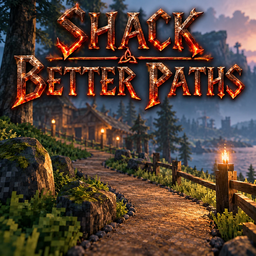

# Shack Better Paths

**[Download on Thunderstore](https://thunderstore.io/c/valheim/p/TheShackDev/Shack_Better_Paths/)** · version 1.1.0 · part of [The Shack Pack](https://thunderstore.io/c/valheim/p/TheShackDev/The_Shack_Pack/)

The hoe's **Pathen** makes smooth paths, and **Paved road** lays stone over them. Vanilla Pathen leaves the ground as rough as it was, and Paved road flattens everything to one height, so a path up a hill turns into steps. With this mod, Pathen grades the ground into an even slope from your feet to where you aim, and Paved road paints stone over the path without touching its shape.

## Pathen: grade a path

- Equip the hoe, pick **Pathen**, stand where the path starts and aim where it should go.
- Each click grades a strip from **your feet** to **the aim point**:
  - **flat from side to side**, with an **even slope** along it;
  - the sides and the far end **blend into the ground** around them, so there are no ledges or lumps;
  - then it's painted **dirt**, and the grass on it is cleared.
- **Nothing behind your feet changes.** Walk to the end of the strip you just made and click again: the next strip carries on from exactly where the last one ended, with no step.
- Going across a hillside, the path cuts in flat with sloped banks on either side.
- Hold **Shift** for vanilla Pathen (paints dirt only).

## Paved road: stone over the path

- **Paved road only paints.** It never changes the height, so a path you graded keeps its grade.
- It paints along the same kind of strip, from your feet to where you aim, so you can walk your path again and pave it.
- By default it lays stone **only where the ground is already dirt or paved**: the part of a click that reaches onto grass leaves the grass alone.
- Hold **Shift** to paint a round patch where you aim, for touch-ups.

## In the build camera (Shack Magic Cam)

Your character stays at the workbench, so a strip can't start at your feet. Instead each click **connects to your previous click** with the same tool:

- The first click marks the start (a round patch), and a "New path" message appears.
- Each click after that grades (Pathen) or paves (Paved road) from your last click to where you aim.
- A click more than **8 m** from the last one starts a new path, and so does leaving or re-entering the camera.
- Pathen and Paved road keep separate chains: lay a path with Pathen, switch to Paved road, and click along it again.

Other build cameras work the same way, as long as the camera is more than 15 m from your character.

**Level ground** and the other hoe tools are unchanged. Paths are ordinary terrain: they stay as they are if the mod is ever removed. Like vanilla terrain edits, the ground can't be moved more than 8 m from its original height.

## Cost

- **Pathen** is free, like vanilla.
- **Paved road** takes its stone **once per 2 m** of strip, rounded up (a 5 m strip takes 3 stone; a round patch takes 1). Stone in nearby chests counts, if a mod like CraftFromContainers lets you build from chests.
- Short of stone, it paves as far as your stone covers and says so ("Out of Stone: paved 4 of 5.2 m").
- Stamina and hoe wear are the same as vanilla, per click.

## Limits

- On foot, a click more than **8 m** from your feet is refused.
- The whole strip must be outside other players' wards and outside no-build areas (dungeons, boss altars), not just the aim point.

## Settings

Set by the server admin in F1 (**Shack Better Paths**). The server's values apply to everyone.

**1 - Tools**
- **Pathen grades** (on). Off: vanilla Pathen.
- **Paved road paints** (on). Off: vanilla Paved road (smooths the ground toward the height of your feet).
- **Paved road only on paths** (on). Off: Paved road paves the whole strip, grass included.

**2 - Shape**
- **Path width** (4 m): width of the flat part. Vanilla Pathen paints 4 m.
- **Edge blend** (1.5 m): how far past the sides and the end the path fades into the ground. 0 = hard edges.
- **Paint margin** (0.25 m): how far past each side the dirt or paving goes, so the edges come out clean.
- **Max distance from feet** (8 m): the longest strip; in the build camera, how far apart two clicks can be and still connect.

**3 - Cost**
- **Paved road meters per stone** (2). 0 = one stone per click, like vanilla.

## Multiplayer

**The server and every player need this mod, at the same minor version** (1.1.x with 1.1.x). A terrain edit is carried out by whichever player's game is looking after that patch of ground, so everyone must know how. Jotunn turns away anyone without it, or with a different minor version.

Part of [The Shack Pack](https://thunderstore.io/c/valheim/p/TheShackDev/The_Shack_Pack/).

## Building from source

You need the [.NET SDK](https://dotnet.microsoft.com/download) (6.0 or newer) and Valheim. The project compiles against your own copies of the game's DLLs and BepInEx and Jotunn; none of them are in this repo.

```bash
dotnet build -c Release \
  -p:ValheimManaged="/path/to/Valheim/valheim_Data/Managed" \
  -p:ProfileRoot="/path/to/your/profile/BepInEx"
```

`ProfileRoot` is the `BepInEx` folder of any r2modman profile that has Jotunn (it needs `core/` and `plugins/ValheimModding-Jotunn/`). Without the `-p:` options the project looks for a Linux Steam install and an r2modman profile named "The Shack Pack Test Environment". The DLL lands in `bin/Release/`.

This is the source of version 1.1.0 on Thunderstore.

## License

MIT, see [LICENSE](LICENSE).
